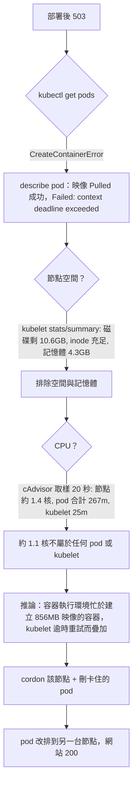
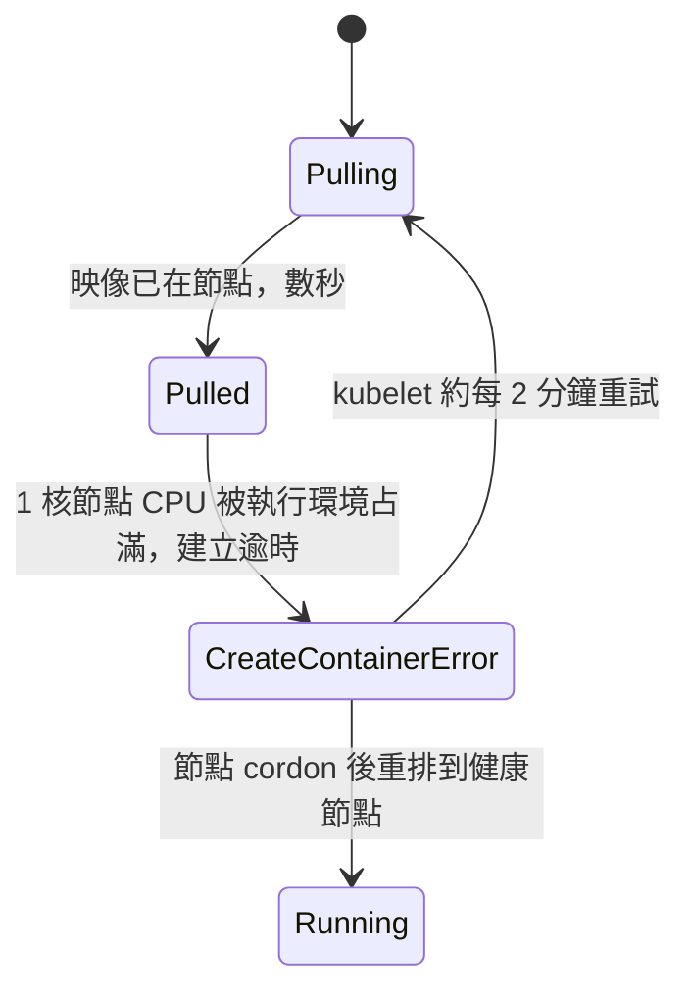
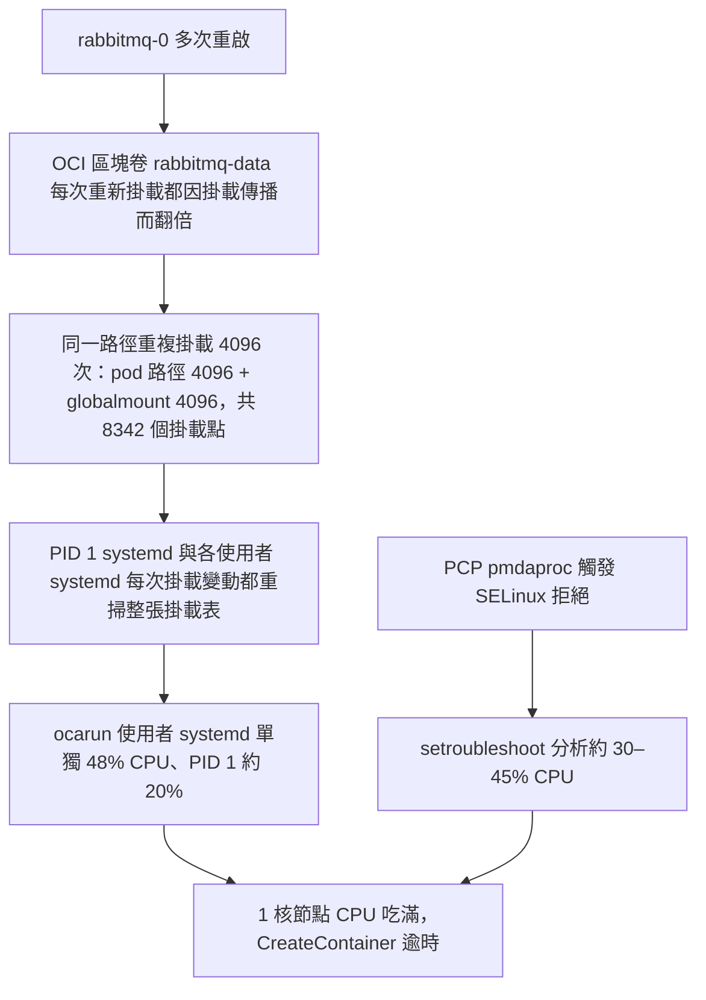

# 節點建立容器逾時（CreateContainerError）事件與修法

> **2026-11-08 更新：根因已查明並修復，見下方「根因（已證實）」。** 原先「容器執行環境吃 CPU」的推論是錯的：crio 只占 0.4% CPU。

2026-11-08 frontend 部署後網站回 503 約一小時。部署策略是 `Recreate`，舊 pod 先停，新 pod 在 `10.0.159.167` 卡在 `CreateContainerError: context deadline exceeded`，沒有任何 pod 服務。

## 症狀與判斷流程





## 已驗證與未驗證

- 已驗證：磁碟、inode、記憶體都充足；節點只有 1 核，量到約 1.4 核；pod 加 kubelet 只占約 0.3 核；映像每次秒拉成功；刪 pod 後仍重排到同一節點並再次卡住；cordon 後排到 `10.0.158.183`，約 1 分鐘 Running，`https://tymultiverse.cc/learn/` 回 200。
- **未驗證（推論）**：吃 CPU 的是容器執行環境。該節點無法 SSH（從 bastion 與 `oke-node` 皆逾時），`oke-node` 的 instance principal 讀不到該 instance（`NotAuthorizedOrNotFound`），所以看不到行程清單。須從 OCI 主控台 Cloud Shell 或 Console Connection 進入節點，執行 `top` 才能確認。
- `oke-node`（`10.0.0.69`）是跳板機，不是叢集節點；在它上面看不到叢集節點的 kubelet 日誌。

## 修法（本次已做）

```bash
ssh oke-node "kubectl cordon 10.0.159.167"
ssh oke-node "kubectl delete pod <卡住的 frontend pod> -n default --wait=false"
ssh oke-node "kubectl get pods -n default -o wide | grep ty-multiverse-frontend"   # 確認排到另一台並 1/1 Running
```

注意：pod 標籤 `app=ty-multiverse-frontend` 選不到 pod，要用完整名稱刪除。

## 待辦

1. **uncordon 前先查根因**：`ssh oke-node "kubectl uncordon 10.0.159.167"` 只在確認原因並處理後做。目前該節點仍是 cordon，所有新 pod 只能排到 `10.0.158.183`（同樣是 1 核節點，要留意其容量）。
2. 從 OCI 主控台進 `10.0.159.167` 跑 `top`、`systemctl status crio`（或 containerd），確認吃 CPU 的行程；必要時重啟容器執行環境或重開節點。
3. 預防（尚未實作）：frontend deployment 由 `Recreate` 改為 `RollingUpdate`（`maxUnavailable: 0`），新 pod 起不來時舊的繼續服務；縮小 frontend 映像（目前 856MB）；評估 CPU limit 75m 對啟動與節點負載的影響。
4. 同節點的 keycloak、gateway、backend、rabbitmq 一旦重啟也可能起不來，處理前避免重啟它們。

## 開發方法

1. 先看 `kubectl get pods` 與 `describe pod` 的事件，分辨「拉不到映像」與「建立容器失敗」；映像已 `Pulled` 就不是映像或登入問題。
2. 用 kubelet 的唯讀介面量節點，不改任何東西：`kubectl get --raw /api/v1/nodes/<node>/proxy/stats/summary`（磁碟、記憶體、各 pod CPU）與 `.../proxy/metrics/cadvisor`（隔 20 秒取兩次，相減得 CPU 速率）。
3. 把量到的數字分成「已驗證」和「推論」寫下，推論不當成結論。
4. 恢復服務是獨立步驟：cordon 與刪 pod 都改正式環境，先取得維運者同意；刪 pod 若重排回同一節點，再 cordon。
5. 之後類似的部署：先確認策略是不是 `Recreate`；`Recreate` 加單節點資源緊張時，部署本身就會造成停機。


## 根因（已證實，2026-11-08 14:00–14:30 UTC）



查法：`kubectl debug node/10.0.159.167 --image=busybox:1.36 --profile=sysadmin -- chroot /host sh -c '...'`（節點不能 SSH，但 debug pod 可以進主機命名空間；小映像能正常建立容器）。

| 時間 | 量測 | 數值 |
|---|---|---|
| 修復前 | `top`（5 秒樣本） | `systemd`(ocarun) 48.5%、`setroubleshoot` 27.6%+19.3%、PID 1 16%；crio 0.4% |
| 修復前 | `wc -l /proc/1/mountinfo` | 8342；同一 CSI 卷（`csi-8ad31b60…`，PVC `rabbitmq-data-rabbitmq-0`）pod 路徑 4096 次、globalmount 4096 次 |
| 修復前 | SELinux 拒絕 | `pmdaproc` getattr，5 分鐘 20 次；`getenforce` = Permissive |
| 修復後 | 掛載數 | 151，rabbitmq 卷 1 次 |
| 修復後 | cAdvisor 30 秒 | 節點 328m，其中 pod 286m（重開後 Java 暖機），pod 以外約 30m（修復前約 700m） |

## 修法（已執行）

1. `systemctl stop user@986.service`（ocarun 使用者 systemd，自 2026-09-09 起常駐）：CPU 由 0% 閒置變 95% 閒置，但數十秒後 root 使用者 systemd 又空轉，證明根因是掛載表，不是單一行程。
2. `systemctl disable --now pmie pmlogger pmcd`、`systemctl mask --now setroubleshootd`：消除 SELinux 拒絕與 setroubleshoot 分析。復原：`systemctl unmask setroubleshootd; systemctl enable --now pmcd pmlogger pmie`。
3. 經使用者同意重開節點（`systemctl reboot`，約 7 分鐘恢復）：洩漏掛載清空，所有 pod 原地重啟成功，網站 200。
4. `kubectl uncordon 10.0.159.167`。
5. image-server 快取與 MIME 修正，設定檔進版控：`image-server/nginx.conf`（見 `image-server/README.md`）。驗證結果：`video/mp4`、`image/png`、單一 `Cache-Control: public, max-age=86400, must-revalidate`。

## 預防與待辦

- **監控掛載數**：`/proc/1/mountinfo` 超過 1000 行就是異常；rabbitmq-0 每次重啟後檢查 `grep -c 8ad31b60 /proc/1/mountinfo` 應為 1。若再翻倍，查 OCI CSI node plugin 版本與掛載傳播設定。
- 另一台 `10.0.158.183`：掛載數 187 正常，但 10 分鐘 498 次 SELinux 拒絕；同樣停用 PCP、遮蔽 setroubleshootd 後拒絕降為 0，CPU 閒置由 66.8% 升到 89.9%。兩台都已處理。
- **已完成**：frontend 改為 `RollingUpdate`（`maxSurge: 1`、`maxUnavailable: 0`）＋ readinessProbe `GET /robots.txt`。Jenkins Deploy stage 每次以 `kubectl patch` 強制套用，`k8s/deployment.yaml` 同步（frontend commit 見 `tests/build/deployStrategy.test.ts`）。上線時每 5 秒打站 40 次，全為 200。
- 重開節點只清掉症狀，掛載翻倍的觸發條件（rabbitmq 重啟後 CSI 重新掛載）還在。
