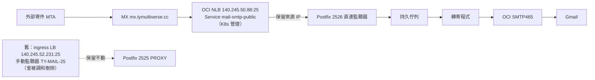

# 自有網域郵件操作手冊

更新：2026-10-29。主信箱 `tianyikao@peoplesystem.tatdvsonorth.com`，目的信箱 `tianyikao@gmail.com`。

## 架構與邊界

```text
外部寄件 MTA → MX → 現有 OCI LB TCP25（PROXY v1）
  → worker NodePort31225 → Postfix2525 → 持久佇列
  → nobody 執行的轉寄程式 → OCI SMTP465 TLS → Gmail
```

一般 port25 留給內部 SMTP 與健康測試；公開流量走要求 PROXY header 的2525。Postfix終止 STARTTLS，使用 cert-manager 簽發的 Let's Encrypt 憑證。既有 ingress-nginx 的80、443與PostgreSQL5432不變。

OCI backend set/listener：`TY-MAIL-25`，backend為 `10.0.158.183:31225`，TCP健康檢查同埠；listener為TCP25、idle300秒、PROXYv1、無隱含SSL終止。LB公網IP為140.245.52.231。實際LB OCID需由Console核對；舊Service annotation有過期OCID，不能直接當作正確資源。

## DNS

以下名稱位於 Hostinger 的 `tatdvsonorth.com` zone，TTL300。

| 類型 | 相對名稱 | 值 |
| --- | --- | --- |
| A | mx.peoplesystem | 140.245.52.231 |
| MX | peoplesystem | 優先序10，mx.peoplesystem.tatdvsonorth.com |
| TXT | peoplesystem | v=spf1 include:ap.rp.oracleemaildelivery.com -all |
| CNAME | oci20261029._domainkey.peoplesystem | oci20261029.peoplesystem.tatdvsonorth.com.dkim.xsp1.oracleemaildelivery.com |

`smtp-out.peoplesystem` A指向140.245.44.81，是先前直接外寄／PTR路線的紀錄，不是目前MX，也不是OCI寄信endpoint。根網域的Hostinger MX／SPF保留。

網路規則：LB安全清單允許0.0.0.0/0到TCP25；LB出站只新增10.0.158.183/32 TCP31225；worker NSG入站只新增10.0.128.0/27 TCP31225。不要為此開放所有worker埠或改動其他listener。

## OCI 身分與秘密

- Compartment：`ty-mail`；Email Domain：`peoplesystem.tatdvsonorth.com`。
- 專用user/group：`ty-mail-relay`，只有SMTP credentials能力，無Console本機密碼、API key或Auth token能力。
- Policy：只在ty-mail允許`use approved-senders`，並以`target.approved-sender.email-domain`限制本網域。
- Approved sender只有實際使用的`tianyikao@peoplesystem.tatdvsonorth.com`，必須與上述區室一致。
- Secret：`mail-system/oci-smtp`，key為`relay.json`。`store_smtp_secret.py`只從stdin取得資料，以kubectl create寫入，避免apply註解保存明文；不同既存Secret不覆寫。
- init container將執行期憑證複製到node-local state的私有路徑，owner65534、目錄0500／檔案0400。節點管理員仍可讀取，這不是對root隔離。
- 本次傳輸使用一次性RSA-OAEP加密檔，伺服器直接解密到匯入程式stdin；暫存私鑰與密文已刪除。密碼不放文件、Git、截圖或命令參數。

## 轉寄語意與限制

OCI要求核准的header From與envelope From，不能透明冒用任意外部寄件者。轉寄程式以自有地址寄出，保留原始寄件者／有效Reply-To，提供純文字預覽與完整`original.eml`附件。HTML腳本不執行，驗證連結保留。

收件目的地固定為擁有者Gmail；未知地址在SMTP RCPT階段拒絕，無catch-all，也不信任整個叢集網段作轉寄。外寄失敗回傳EX_TEMPFAIL75，保留Postfix佇列重試；沒有直接TCP25fallback。

目前原信上限1,000,000 bytes，預留包裝與base64附件空間，送OCI前另檢查2,000,000 bytes上限。這不是一般10MB／25MB信箱。接受更大郵件前必須一起調整OCI quota、Postfix及程式兩個大小限制。

佇列在`/var/lib/ty-mail`的node-local hostPath，能承受pod重建，不能承諾節點遺失時不丟信。備份、復原演練與自動憑證更新後的Postfixreload／restart仍需持續維護。

## 部署與驗證

```sh
kubectl apply --dry-run=server -k mail/production
kubectl apply -k mail/production
kubectl -n mail-system rollout status statefulset/ty-mail --timeout=300s
kubectl -n mail-system get certificate mail-public
kubectl -n mail-system exec ty-mail-0 -- postqueue -p
python -B -m unittest discover -s mail/tests -p test_oci_forward.py -v
python -B -m unittest discover -s mail/tests -p test_store_smtp_secret.py -v
```

pod內執行`verify_smtp.py`九項、`verify_oci_config.py`五項、`verify_proxy_smtp.py`四項；設定parser測試可用RELAY_CONFIG_DIR檢查候選目錄。外部探測需驗證系統CA／hostname、正確地址250、未知地址550、外部relay554，不能只看TCP可連。

2026-10-29已確認Gmail收到OCI轉寄測試信，顯示本網域DKIM、TLS與original.eml；公開SMTP也通過TLS1.3及收件限制檢查。MX已公開解析。完整Gmail往返信主旨為`TY public mail roundtrip 20261029-1137`，Postfix佇列ID為`39E57243B882`，Google來源IP為209.85.161.52；已確認轉寄信回到Gmail Inbox，而非只排入佇列。

## 用自訂地址寄信

**時效限制（2026-10-29查證）：Google官方公告2027年1月起停止第三方地址Send-as；Google Workspace alias與其他Gmail地址不受此項公告影響。因此Gmail外部SMTP設定只適合目前過渡使用，長期應選支援獨立SMTP身分的客戶端，或另行規劃Workspace網域信箱。**

可以在Gmail「設定→查看所有設定→帳戶和匯入→以其他地址寄信→新增其他電子郵件地址」設定此地址，並選擇透過OCI SMTP寄送。Gmail會寄確認信到該地址，經本系統轉回Gmail後完成驗證。

SMTP server：`smtp.email.ap-singapore-2.oci.oraclecloud.com`；587搭配STARTTLS，或465搭配SSL/TLS；帳號與密碼是OCI產生的SMTP credentials，帳號不是email地址，也不是Google密碼。From與envelope From須符合Approved Sender。

建議為Gmail／個人郵件軟體另建可獨立撤銷的SMTP憑證，限制同一核准地址，勿共用自動轉寄憑證。目前只完成伺服器憑證，尚未替Gmail建立或保存寄件憑證。此手冊不代表Gmail已能以該地址寄出。

Thunderbird、Apple Mail等可設定獨立SMTP identity，但收件仍用Gmail帳戶；這套系統沒有新增IMAP／POP信箱。部分軟體的簡化帳戶設定不接受這種收寄分離，需要進階設定。Gmail的Send-as不保證自動同步成其他軟體的寄件身分。

官方：[Gmail Send as](https://support.google.com/mail/answer/22370?hl=en)、[OCI SMTP設定](https://docs.oracle.com/en-us/iaas/Content/Email/Reference/gettingstarted_topic-Configure_the_SMTP_connection.htm)。

## 2026-11-09 公開入口改為 Kubernetes 管理的專用 NLB

**事故：** 外部寄到 `tianyikao@tymultiverse.cc` 的信（Spotify 驗證碼）沒有到。外部連 140.245.52.231:25 逾時（同一個 IP 的 443 正常、本機連 Gmail MX 的 25 埠正常），但 Pod 內 2525 收件正常。原因推定：TCP25 監聽器 `TY-MAIL-25` 是在 Console **手動**加到 ingress-nginx 的 LB 上，該 LB 由 OCI cloud-controller 依 ingress-nginx Service（只宣告 80／443／5432）調和，手動監聽器會在調和時消失。因無 OCI 讀取權限，未直接證實監聽器已被刪除。

**修正：** 新增 `mail/production/smtp-public-nlb.yaml`：`type: LoadBalancer` 的 OCI Network Load Balancer，`is-preserve-source` 加 `externalTrafficPolicy: Local` 保留來源 IP，25 → Postfix 新的直連監聽器 2526（`oci-relay/user-patches.sh`，不需 PROXY header，收件限制同 25 埠）。舊 2525／`TY-MAIL-25` 路徑保留未動。



**驗證：** `mail/tests/verify_direct_smtp.py`（5 項）部署前在 Pod 內紅燈（2526 未開），部署後綠燈；`verify_smtp.py` 11/11、`verify_proxy_smtp.py` 4/4 維持綠燈。從外部直連 140.245.50.88:25：banner 220、兩個網域的 `tianyikao@` 回 250、未知地址 550、外部轉送 554、STARTTLS 憑證含兩個 mx 名稱。

**DNS：** Porkbun `mx.tymultiverse.cc` A 改為 140.245.50.88。舊網域 `mx.peoplesystem.tatdvsonorth.com`（Hostinger）依使用者決定暫不改，仍指向舊 LB。

### 開發方法

1. 先從外部分段測：本機到 Gmail MX 25（排除家用網路擋 25）、到本 LB 的 443 與 25、Pod 內 2525，找出斷在 LB 這段。不要只看 Pod Running、佇列為空就說正常。
2. 先寫 `verify_direct_smtp.py`，在線上 Pod 跑出紅燈，再改設定。
3. **從 Windows 打包 `mail/` 會帶 CRLF**（git `core.autocrlf=true`）；`user-patches.sh` 帶 `
` 會讓 Pod 啟動失敗。部署前在管理節點的副本 `sed -i 's/
$//'`，並確認 `grep -rlI $'
' mail` 為 0。
4. 套用前用 `kubectl apply --dry-run=server` 與 `kubectl diff`，並把新 ConfigMap 逐鍵和線上版本比對，確認只有預期的行改變。
5. 套用後先在 Pod 內跑新舊測試，再從外部對新 IP 測，最後才改 DNS 並做真實往返。

### 回復與待辦

- 回復：`kubectl -n mail-system delete svc mail-smtp-public`（NLB 會移除），Porkbun A 改回 140.245.52.231。2526 監聽器留著無害。
- 待辦：NLB 的公開 IP 是**臨時 IP**，Service 被刪除重建就會變；要固定需在 OCI 申請保留公開 IP，並在 Service 指定。`security-list-management-mode: All` 讓 cloud-controller 自動開放該 NodePort 與健康檢查埠。
